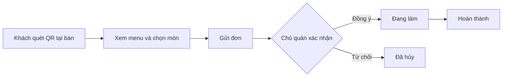

# 🍵 QuickOrder – Ứng dụng gọi món tại bàn cho quán nhỏ

> Đồ án cuối kỳ môn **Công nghệ phần mềm** – Khoa Công nghệ Thông tin và Truyền thông, Đại học CMC
> Nhóm thực hiện: **Nhóm TULO**


---

## 📌 Mục lục

1. [Giới thiệu](#-giới-thiệu)
2. [Luồng hoạt động](#-luồng-hoạt-động)
3. [Vấn đề và giải pháp](#-vấn-đề-và-giải-pháp)
4. [Đối tượng người dùng](#-đối-tượng-người-dùng)
5. [Chức năng chính](#-chức-năng-chính)
6. [Công nghệ sử dụng](#-công-nghệ-sử-dụng)
7. [Cấu trúc thư mục](#-cấu-trúc-thư-mục)
8. [Hướng dẫn cài đặt và chạy](#-hướng-dẫn-cài-đặt-và-chạy)
9. [Tài khoản demo](#-tài-khoản-demo)
10. [Tài liệu dự án](#-tài-liệu-dự-án)
11. [Quy trình làm việc nhóm](#-quy-trình-làm-việc-nhóm)
12. [Kế hoạch thực hiện](#-kế-hoạch-thực-hiện)
13. [Thành viên nhóm](#-thành-viên-nhóm)

---

## 📖 Giới thiệu

**QuickOrder** là ứng dụng web giúp các quán ăn, quán nước quy mô nhỏ (trà sữa, cà phê, cơm, bún phở) nhận và quản lý đơn gọi món **ngay tại bàn**.

- Mỗi bàn có **một mã QR**. Khách ngồi tại quán quét mã bằng điện thoại, xem menu và gọi món, **không cần cài ứng dụng, không cần đăng nhập**.
- Đơn được gửi **thẳng đến quầy/bếp**. Chủ quán nhận đơn, cập nhật trạng thái và theo dõi doanh thu ngay trên hệ thống.
- **Không thu phí hoa hồng** cho nền tảng trung gian.
- Hệ thống chỉ phục vụ **khách ăn tại quán**, không có đặt hàng từ xa hay giao hàng.

## 🔄 Luồng hoạt động



## 🎯 Vấn đề và giải pháp

**Vấn đề:** các quán nhỏ hiện nhận món chủ yếu bằng cách nhân viên ghi tay hoặc gọi miệng tại bàn, dẫn đến:

- Dễ nhầm đơn, sót món, khó theo dõi trạng thái từng đơn.
- Khách phải vẫy gọi nhân viên nhiều lần, chờ lâu mới được ghi món; không biết món còn hay hết.
- Chủ quán không có số liệu thống kê doanh thu, món bán chạy để ra quyết định kinh doanh.
- Các nền tảng lớn thu phí hoa hồng cao, quán nhỏ khó chịu nổi.

**Giải pháp:** hệ thống gọi món tại bàn gồm ba phân hệ **Khách hàng – Chủ quán – Quản trị viên**.

## 👥 Đối tượng người dùng

| Vai trò | Mục tiêu sử dụng |
|---|---|
| **Khách hàng** (ngồi tại quán) | Quét QR, xem menu, gọi món nhanh, theo dõi đơn; không cần tài khoản |
| **Chủ quán / nhân viên** | Quản lý bàn và QR, quản lý menu, nhận đơn, cập nhật trạng thái, xem thống kê |
| **Quản trị viên (Admin)** | Duyệt và khóa quán, quản lý người dùng, xem thống kê chung, xử lý khiếu nại |

## ✨ Chức năng chính

### 🛒 Phân hệ khách hàng (không cần đăng nhập)
- Quét mã QR tại bàn để mở menu đúng quán, gắn sẵn số bàn
- Xem menu, tìm món, lọc theo danh mục
- Chọn món kèm tùy chọn (size, topping, ghi chú), quản lý giỏ hàng
- Gửi đơn thẳng đến quầy bếp; gọi thêm món bất cứ lúc nào
- Thanh toán bằng tiền mặt tại quầy hoặc chuyển khoản/QR
- Theo dõi trạng thái đơn: *Chờ xác nhận → Đang làm → Hoàn thành*; hủy đơn khi chưa được xác nhận
- *(Nâng cao)* Đăng ký tài khoản tùy chọn để xem lịch sử, đặt lại món, đánh giá quán và món

### 🏪 Phân hệ chủ quán
- Đăng ký quán, quản lý thông tin quán và giờ mở cửa
- **Quản lý bàn và tạo mã QR** cho từng bàn
- Quản lý menu: thêm, sửa, xóa món, hình ảnh, giá, tùy chọn, đánh dấu hết món
- **Nhận thông báo đơn mới**, xác nhận hoặc từ chối đơn, cập nhật trạng thái đơn
- Xác nhận thanh toán; *(nâng cao)* tính tiền theo bàn
- *(Nâng cao)* Mã giảm giá, thống kê doanh thu theo ngày/tháng và món bán chạy

### 🛡️ Phân hệ quản trị viên
- Duyệt hoặc khóa tài khoản quán
- Quản lý người dùng và danh mục món
- Thống kê toàn hệ thống, xử lý khiếu nại

### 🚀 Điểm nổi bật
- **Gọi món bằng QR tại bàn:** khách quét là gọi, không cần app, không cần đăng ký
- **Thông báo đơn mới** cho chủ quán theo thời gian thực
- **Không thu hoa hồng**
- **Gợi ý món hay đặt** dựa trên lịch sử và món bán chạy

### 📊 Mức độ ưu tiên

| Mức | Chức năng |
|---|---|
| **Bắt buộc** (làm trước) | Đăng ký, đăng nhập, phân quyền (chủ quán, admin); quản lý bàn và QR; quản lý menu; quét QR, xem menu, giỏ hàng, gửi đơn; xử lý và cập nhật trạng thái đơn; xác nhận thanh toán |
| **Nâng cao** (nếu còn thời gian) | Thống kê doanh thu, mã giảm giá, đánh giá món, tính tiền theo bàn, lịch sử đơn cho khách có tài khoản, trang Admin hoàn chỉnh |
| **Mở rộng** (ngoài kế hoạch) | Thanh toán trực tuyến qua cổng thanh toán |

### ⚙️ Yêu cầu phi chức năng
- Giao diện responsive, ưu tiên điện thoại (khách dùng điện thoại để quét QR)
- Thời gian tải trang dưới 3 giây
- Bảo mật: mã hóa mật khẩu, phân quyền rõ ràng, chống SQL injection, mã bàn (QR) ngẫu nhiên khó đoán
- Xử lý được nhiều bàn gọi món cùng lúc mà không phát sinh lỗi

## 🛠️ Công nghệ sử dụng

| Thành phần | Công nghệ |
|---|---|
| Backend | Python, Flask |
| Frontend | HTML, CSS, Bootstrap 5, JavaScript |
| Template engine | Jinja2 |
| Cơ sở dữ liệu | SQLite (có thể nâng lên MySQL) |
| ORM | SQLAlchemy |
| Biểu đồ | Chart.js |
| Mã QR | Thư viện `qrcode` |
| Quản lý mã nguồn | Git, GitHub |
| Quản lý công việc | Trello / GitHub Projects |
| Thiết kế | Figma, draw.io |
| Triển khai | PythonAnywhere / Render |

## 📁 Cấu trúc thư mục

> ⚠️ Cấu trúc dưới đây là bản dự kiến, sẽ được cập nhật khi dự án phát triển.

```
CNPM-TULO/
├── app/
│   ├── __init__.py          # Khởi tạo Flask app
│   ├── models.py            # Các model SQLAlchemy
│   ├── auth/                # Đăng ký, đăng nhập, phân quyền
│   ├── customer/            # Menu, giỏ hàng, đơn hàng
│   ├── owner/               # Quản lý quán, bàn, menu, đơn, thống kê
│   ├── admin/               # Trang quản trị
│   ├── api/                 # Endpoint JSON (AJAX, thông báo đơn mới)
│   ├── templates/           # Giao diện Jinja2
│   └── static/              # CSS, JS, hình ảnh
├── docs/                    # Tài liệu dự án (SRS, thiết kế, test case...)
├── tests/                   # Mã kiểm thử tự động
├── config.py                # Cấu hình ứng dụng
├── run.py                   # Điểm chạy ứng dụng
├── requirements.txt         # Danh sách thư viện
├── .env.example             # Mẫu biến môi trường
└── README.md
```

## 🚀 Hướng dẫn cài đặt và chạy

### Yêu cầu
- [Python 3.10+](https://www.python.org/downloads/)
- [Git](https://git-scm.com/)

### Các bước

**1. Clone dự án**
```bash
git clone https://github.com/Caykhongg/CNPM-TULO.git
cd CNPM-TULO
```

**2. Tạo và kích hoạt môi trường ảo**
```bash
# Windows
python -m venv venv
venv\Scripts\activate

# macOS / Linux
python3 -m venv venv
source venv/bin/activate
```

**3. Cài đặt thư viện**
```bash
pip install -r requirements.txt
```

**4. Tạo file cấu hình**
```bash
# Windows
copy .env.example .env

# macOS / Linux
cp .env.example .env
```
Mở file `.env` và chỉnh các giá trị cần thiết:
```
SECRET_KEY=doi-thanh-chuoi-bi-mat-cua-ban
DATABASE_URL=sqlite:///quickorder.db
```

**5. Khởi tạo cơ sở dữ liệu và dữ liệu mẫu**
```bash
python init_db.py
```

**6. Chạy ứng dụng**
```bash
flask --app run run --debug
```
Truy cập: **http://127.0.0.1:5000**

### Chạy kiểm thử
Chạy trong thư mục `QuickOrder/` (không cần cài thêm thư viện):
```bash
python -m unittest discover -s tests -v
```
(`pytest` cũng chạy được các test này.)

### Gửi email xác nhận khi khách đăng ký
Khách đăng ký tài khoản sẽ nhận mã 6 số qua email. Đặt các biến môi trường sau trên máy chủ (Render: tab **Environment**):

| Biến | Ý nghĩa |
|---|---|
| `MAIL_API_KEY` | Khóa API của Brevo (brevo.com) |
| `MAIL_FROM` | Email người gửi, phải được xác minh trên Brevo |
| `MAIL_FROM_NAME` | Tên người gửi (tùy chọn, mặc định `QuickOrder`) |
| `HTTPS` | Đặt `1` khi chạy trên HTTPS (Render), để cookie đăng nhập chỉ đi qua HTTPS |

Khi thử trên máy chưa có khóa API, đặt `MAIL_CONSOLE=1`: mã xác nhận sẽ in ra terminal thay vì gửi thư. Không bật biến này trên máy chủ thật.

> 📝 *Các lệnh ở bước 5 và 6 sẽ được TV4 (Backend) xác nhận lại khi hoàn tất khung dự án.*

## 🔑 Tài khoản demo

> Sẽ cập nhật sau khi có dữ liệu mẫu. Khách hàng không cần tài khoản: chỉ cần mở đường dẫn QR của một bàn.

| Vai trò | Email | Mật khẩu |
|---|---|---|
| Admin | `admin@quickorder.vn` | `...` |
| Chủ quán | `owner@quickorder.vn` | `...` |

🔗 **Bản demo trực tuyến:** *(cập nhật sau khi deploy)*

## 📚 Tài liệu dự án

Toàn bộ tài liệu nằm trong thư mục [`docs/`](./docs).

| Tài liệu | Trạng thái |
|---|---|
| Danh sách chức năng | ✅ Hoàn thành; 17/49 chức năng Sprint 1 đã Hoàn thành ([xem file](docs/Danh_sach_chuc_nang_QuickOrder.xlsx)) |
| Đặc tả yêu cầu phần mềm (SRS) | ✅ Bản 1.0, hoàn thành Sprint 0–1 ([xem file](docs/SRS_QuickOrder_v1.0.docx)) |
| Use Case | ✅ Bản 1.0, hoàn thành Sprint 0–1 ([xem file](docs/UseCase_QuickOrder_v1.0.docx)) |
| User Story | ✅ Hoàn thành; 17 story Sprint 1 đã Hoàn thành, bản 0.1 ([xem file](docs/UserStory_QuickOrder_v0.1.xlsx)) |
| Thiết kế CSDL (ERD) | ⬜ Chưa làm |
| Class Diagram | ✅ Bản 1.0, hoàn thành Sprint 0–1 ([xem file](docs/ClassDiagram_QuickOrder_v1.0.docx)) |
| Sequence Diagram | ✅ Bản 1.0, 9 luồng chính ([xem file](docs/SequenceDiagram_QuickOrder_v1.0.docx)) |
| Wireframe (Figma) | 🔄 Đã có bản phác thảo 10 màn hình ([xem file](docs/Wireframe_QuickOrder_v1.0.docx)); chờ dựng trên Figma, thêm liên kết Figma khi xong | |
| Cấu trúc Route/API | ✅ Bản 1.0, 82 route và 12 endpoint JSON ([xem file](docs/RouteAPI_QuickOrder_v1.0.docx)) |
| Test case và báo cáo kiểm thử | ⬜ Chưa làm |

## 🤝 Quy trình làm việc nhóm

### Quy ước Git
- Nhánh chính: `main` (luôn ổn định, **không commit trực tiếp**).
- Mỗi người làm trên nhánh riêng: `feature/ten-chuc-nang` (ví dụ `feature/gio-hang`).
- Sửa lỗi: `fix/ten-loi`; tài liệu: `docs/ten-tai-lieu`.
- Tạo **Pull Request** và có ít nhất 1 thành viên review trước khi gộp vào `main`.

### Quy ước commit
```
<loại>: <mô tả ngắn>

feat: thêm chức năng thêm món vào giỏ hàng
fix: sửa lỗi tính sai tổng tiền
docs: cập nhật tài liệu SRS
test: thêm test case đăng nhập
refactor: tách hàm tính giá
```

### Quản lý công việc
- Bảng công việc có các cột: **To Do → In Progress → Review → Done**.
- Họp nhóm 1–2 lần mỗi tuần (lập kế hoạch đầu tuần, tổng kết cuối tuần) và ghi biên bản.

## 📅 Kế hoạch thực hiện

| Tuần | Giai đoạn | Nội dung chính |
|---|---|---|
| 1–3 | ✅ **Sprint 0** | Chuẩn bị, phân tích và thiết kế (SRS, Use Case, ERD, wireframe...) |
| 4–5 | ✅ **Sprint 1** | Nền tảng, menu và QR bàn: đăng ký/đăng nhập, phân quyền, quản lý quán, menu, bàn và mã QR, quét QR xem menu |
| 6–7 | 🔄 **Sprint 2** (đang thực hiện) | Gọi món và xử lý đơn: giỏ hàng, gửi đơn, thanh toán, thông báo đơn mới, cập nhật trạng thái |
| 8 | **Sprint 3** | Tính năng nâng cao: thống kê, mã giảm giá, đánh giá, lịch sử đơn, hoàn thiện trang Admin |
| 9 | **Sprint 4** | Kiểm thử tổng thể, đo hiệu năng, sửa lỗi |
| 10 | Hoàn thiện | Deploy, tài liệu hướng dẫn, báo cáo, slide, demo |

## 👨‍💻 Thành viên nhóm

| STT | Họ và tên | MSSV | Vai trò |
|---|---|---|---|
| 1 | Nguyễn Xuân Anh | BIT250010 | Trưởng nhóm, BA |
| 2 | Phạm Tuấn Anh | BIT250035 | Frontend khách hàng |
| 3 | Nguyễn Huỳnh Tuấn Anh | BIT250018 | Frontend chủ quán, Admin |
| 4 | Nguyễn Tú Anh | BIT253653 | Backend, Database |
| 5 | Triệu Nguyễn Khải | BIT253659 | Tester, DevOps |

**Giảng viên hướng dẫn:** *(điền tên)*

---

<p align="center">Đồ án môn Công nghệ phần mềm – Đại học CMC – Hà Nội, 2026</p>
