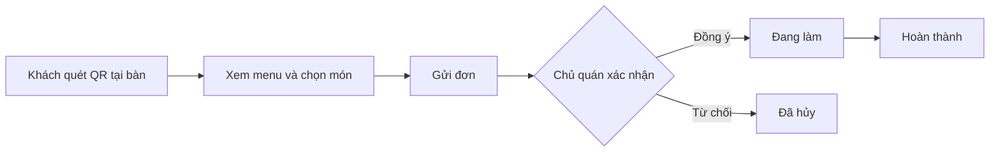

# 🍵 QuickOrder – Ứng dụng gọi món tại bàn cho quán nhỏ

> Đồ án cuối kỳ môn **Công nghệ phần mềm** – Khoa Công nghệ Thông tin và Truyền thông, Đại học CMC
> Nhóm thực hiện: **Nhóm TULO**


---

## 📌 Mục lục

1. [Giới thiệu](#-giới-thiệu)
2. [Luồng hoạt động](#-luồng-hoạt-động)
3. [Vấn đề và giải pháp](#-vấn-đề-và-giải-pháp)
4. [Đối tượng người dùng](#-đối-tượng-người-dùng)
5. [Chức năng chính](#-chức-năng-chính)
6. [Công nghệ sử dụng](#-công-nghệ-sử-dụng)
7. [Cấu trúc thư mục](#-cấu-trúc-thư-mục)
8. [Hướng dẫn cài đặt và chạy](#-hướng-dẫn-cài-đặt-và-chạy)
9. [Tài khoản demo](#-tài-khoản-demo)
10. [Tài liệu dự án](#-tài-liệu-dự-án)
11. [Quy trình làm việc nhóm](#-quy-trình-làm-việc-nhóm)
12. [Kế hoạch thực hiện](#-kế-hoạch-thực-hiện)
13. [Thành viên nhóm](#-thành-viên-nhóm)

---

## 📖 Giới thiệu

**QuickOrder** là ứng dụng web giúp các quán ăn, quán nước quy mô nhỏ (trà sữa, cà phê, cơm, bún phở) nhận và quản lý đơn gọi món **ngay tại bàn**.

- Mỗi bàn có **một mã QR**. Khách ngồi tại quán quét mã bằng điện thoại, xem menu và gọi món, **không cần cài ứng dụng, không cần đăng nhập**.
- Đơn được gửi **thẳng đến quầy/bếp**. Chủ quán nhận đơn, cập nhật trạng thái và theo dõi doanh thu ngay trên hệ thống.
- **Không thu phí hoa hồng** cho nền tảng trung gian.
- Hệ thống chỉ phục vụ **khách ăn tại quán**, không có đặt hàng từ xa hay giao hàng.

## 🔄 Luồng hoạt động



## 🎯 Vấn đề và giải pháp

**Vấn đề:** các quán nhỏ hiện nhận món chủ yếu bằng cách nhân viên ghi tay hoặc gọi miệng tại bàn, dẫn đến:

- Dễ nhầm đơn, sót món, khó theo dõi trạng thái từng đơn.
- Khách phải vẫy gọi nhân viên nhiều lần, chờ lâu mới được ghi món; không biết món còn hay hết.
- Chủ quán không có số liệu thống kê doanh thu, món bán chạy để ra quyết định kinh doanh.
- Các nền tảng lớn thu phí hoa hồng cao, quán nhỏ khó chịu nổi.

**Giải pháp:** hệ thống gọi món tại bàn gồm ba phân hệ **Khách hàng – Chủ quán – Quản trị viên**.

## 👥 Đối tượng người dùng

| Vai trò | Mục tiêu sử dụng |
|---|---|
| **Khách hàng** (ngồi tại quán) | Quét QR, xem menu, gọi món nhanh, theo dõi đơn; không cần tài khoản |
| **Chủ quán / nhân viên** | Quản lý bàn và QR, quản lý menu, nhận đơn, cập nhật trạng thái, xem thống kê |
| **Quản trị viên (Admin)** | Duyệt và khóa quán, quản lý người dùng, xem thống kê chung, xử lý khiếu nại |

## ✨ Chức năng chính

### 🛒 Phân hệ khách hàng (không cần đăng nhập)
- Quét mã QR tại bàn để mở menu đúng quán, gắn sẵn số bàn
- Xem menu, tìm món, lọc theo danh mục
- Chọn món kèm tùy chọn (size, topping, ghi chú), quản lý giỏ hàng
- Gửi đơn thẳng đến quầy bếp; gọi thêm món bất cứ lúc nào
- Thanh toán bằng tiền mặt tại quầy hoặc chuyển khoản/QR
- Theo dõi trạng thái đơn: *Chờ xác nhận → Đang làm → Hoàn thành*; hủy đơn khi chưa được xác nhận
- *(Nâng cao)* Đăng ký tài khoản tùy chọn (xác nhận bằng mã 6 số gửi qua email) và sửa hồ sơ cá nhân. Xem lịch sử đơn theo tài khoản, đặt lại món, đánh giá quán và món: *dự kiến*. Hiện danh sách đơn được lưu trên thiết bị đang dùng

### 🏪 Phân hệ chủ quán
- Đăng ký quán, quản lý thông tin quán và giờ mở cửa
- **Quản lý bàn và tạo mã QR** cho từng bàn
- Quản lý menu: thêm, sửa, xóa món, hình ảnh, giá, tùy chọn, đánh dấu hết món
- Cấu hình thông tin nhận chuyển khoản: số tài khoản và ảnh QR thanh toán (tải ảnh lên)
- **Nhận thông báo đơn mới** (số đơn chờ trên tiêu đề trang, âm báo tùy chọn), lọc đơn theo trạng thái và ngày, xác nhận hoặc từ chối đơn (kèm lý do), cập nhật trạng thái đơn
- Xác nhận thanh toán; **tính tiền theo bàn** (xem các đơn chưa trả của bàn và thu một lần)
- Thống kê doanh thu theo ngày/tháng và món bán chạy (chỉ tính đơn đã hoàn thành, ngày theo giờ Việt Nam)
- **Mã giảm giá**: tạo, tắt/bật, xóa mã giảm theo % hoặc số tiền, đơn tối thiểu, thời hạn, số lượt; khách nhập mã ở giỏ hàng
- **Xem đánh giá** của khách (điểm trung bình, phân bố sao, nhận xét, điểm từng món); khách đánh giá đơn đã hoàn thành một lần

### 🛡️ Phân hệ quản trị viên
- Duyệt hoặc khóa tài khoản quán
- Quản lý người dùng và danh mục món
- Thống kê toàn hệ thống, xử lý khiếu nại

### 🚀 Điểm nổi bật
- **Gọi món bằng QR tại bàn:** khách quét là gọi, không cần app, không cần đăng ký
- **Thông báo đơn mới** cho chủ quán: trang tự kiểm tra mỗi 7 giây, không cần tải lại
- **Không thu hoa hồng**
- **Gợi ý món hay đặt** dựa trên lịch sử và món bán chạy *(dự kiến)*

### 📊 Mức độ ưu tiên

| Mức | Chức năng |
|---|---|
| **Bắt buộc** (làm trước) | Đăng ký, đăng nhập, phân quyền (chủ quán, admin); quản lý bàn và QR; quản lý menu; quét QR, xem menu, giỏ hàng, gửi đơn; xử lý và cập nhật trạng thái đơn; xác nhận thanh toán |
| **Nâng cao** (nếu còn thời gian) | Thống kê doanh thu, mã giảm giá, đánh giá món, tính tiền theo bàn, lịch sử đơn cho khách có tài khoản, trang Admin hoàn chỉnh |
| **Mở rộng** (ngoài kế hoạch) | Thanh toán trực tuyến qua cổng thanh toán |

### ⚙️ Yêu cầu phi chức năng
- Giao diện responsive, ưu tiên điện thoại (khách dùng điện thoại để quét QR)
- Thời gian tải trang dưới 3 giây
- Bảo mật: mã hóa mật khẩu, phân quyền rõ ràng, chống SQL injection, mã bàn (QR) ngẫu nhiên khó đoán
- Xử lý được nhiều bàn gọi món cùng lúc mà không phát sinh lỗi

## 🛠️ Công nghệ sử dụng

| Thành phần | Công nghệ |
|---|---|
| Backend | Python, Flask (API JSON, phiên đăng nhập phía server) |
| Frontend | HTML, CSS, JavaScript thuần: các trang tĩnh gọi API bằng `fetch` |
| Cơ sở dữ liệu | SQLite, dùng thư viện `sqlite3` có sẵn của Python (không dùng ORM); cấu trúc bảng trong `schema.sql` |
| Biểu đồ | Chart.js (nạp từ CDN) |
| Mã QR | `qrcode.js` (nạp từ CDN, tạo mã QR ngay trên trình duyệt chủ quán) |
| Gửi email xác nhận | Brevo (API) |
| Kiểm thử | `unittest` (có sẵn trong Python) |
| Quản lý mã nguồn | Git, GitHub |
| Quản lý công việc | Trello / GitHub Projects |
| Thiết kế | Figma, draw.io |
| Triển khai | Render (chạy bằng `gunicorn`) hoặc PythonAnywhere |

## 📁 Cấu trúc thư mục

```
CNPM-TULO/
├── QuickOrder/                  # Mã nguồn ứng dụng
│   ├── app.py                   # Flask: API (tài khoản, quán, menu, bàn, đơn hàng, doanh thu) và phục vụ trang tĩnh
│   ├── schema.sql               # Cấu trúc cơ sở dữ liệu SQLite
│   ├── init_db.py               # Tạo database trống (và tài khoản admin nếu đặt biến môi trường)
│   ├── seed_data.py             # Nạp dữ liệu mẫu để chạy thử
│   ├── mailer.py                # Gửi mã xác nhận email khi khách đăng ký
│   ├── requirements.txt         # Thư viện Python (flask, gunicorn)
│   ├── index.html               # Trang chủ
│   ├── customer/                # Giao diện khách: menu, giỏ hàng, đơn hàng, tài khoản, hồ sơ
│   ├── merchant/                # Giao diện chủ quán: thông tin quán, menu, bàn và QR, đơn hàng, doanh thu
│   ├── admin/                   # Giao diện quản trị: duyệt quán
│   ├── css/, js/                # Giao diện dùng chung và hàm gọi API (js/app.js)
│   └── tests/                   # Kiểm thử tự động (unittest)
├── docs/                        # Tài liệu dự án (SRS, Use Case, thiết kế...)
├── QuickOrder_TestCases_Sprint1.docx
├── QuickOrder_TestCases_Sprint2.docx
├── sequence_diagram.md
└── README.md
```

## 🚀 Hướng dẫn cài đặt và chạy

### Yêu cầu
- [Python 3.10+](https://www.python.org/downloads/)
- [Git](https://git-scm.com/)

### Các bước

**1. Clone dự án**
```bash
git clone https://github.com/Caykhongg/CNPM-TULO.git
cd CNPM-TULO
```

**2. Tạo và kích hoạt môi trường ảo**
```bash
# Windows
python -m venv venv
venv\Scripts\activate

# macOS / Linux
python3 -m venv venv
source venv/bin/activate
```

**3. Cài đặt thư viện**
```bash
cd QuickOrder
pip install -r requirements.txt
```

**4. Tạo cơ sở dữ liệu**

Nạp dữ liệu mẫu để chạy thử (có sẵn quán, menu, bàn và tài khoản demo, xem mục [Tài khoản demo](#-tài-khoản-demo)):
```bash
python seed_data.py --reset
```
Hoặc tạo database trống kèm tài khoản admin (dùng khi triển khai thật):
```bash
# macOS / Linux
ADMIN_EMAIL=admin@quickorder.vn ADMIN_PASSWORD=mat-khau-manh python init_db.py

# Windows (PowerShell)
$env:ADMIN_EMAIL="admin@quickorder.vn"; $env:ADMIN_PASSWORD="mat-khau-manh"; python init_db.py
```
> `--reset` xóa toàn bộ dữ liệu cũ trong `database.db`.

**5. Chạy ứng dụng** (vẫn trong thư mục `QuickOrder/`)
```bash
flask --app app run --debug
```
Truy cập: **http://127.0.0.1:5000**

Khi chạy thật nên đặt `SECRET_KEY` cố định, nếu không mỗi lần khởi động lại mọi người sẽ bị đăng xuất.

### Biến môi trường

| Biến | Ý nghĩa |
|---|---|
| `SECRET_KEY` | Khóa ký phiên đăng nhập; đặt một chuỗi bí mật cố định |
| `HTTPS` | Đặt `1` khi chạy trên HTTPS (Render), để cookie đăng nhập chỉ đi qua HTTPS |
| `QO_DB` | Đường dẫn file database (mặc định `QuickOrder/database.db`) |
| `QO_UPLOADS` | Thư mục lưu ảnh QR thanh toán do chủ quán tải lên (mặc định `QuickOrder/uploads`) |
| `ADMIN_EMAIL`, `ADMIN_PASSWORD` | Dùng với `init_db.py` để tạo tài khoản admin (mật khẩu từ 8 ký tự) |
| `FLASK_DEBUG` | Đặt `1` để bật chế độ debug khi chạy `python app.py`; không bật trên máy chủ thật |

> ⚠️ Database và thư mục ảnh tải lên nằm trên ổ đĩa của máy chủ. Nếu nơi triển khai dùng ổ đĩa tạm thời (như gói miễn phí của Render) thì dữ liệu mất khi khởi động lại hoặc triển khai lại; cần gắn ổ đĩa lưu trữ lâu dài và trỏ `QO_DB`, `QO_UPLOADS` vào đó.

### Chạy kiểm thử
Chạy trong thư mục `QuickOrder/` (không cần cài thêm thư viện):
```bash
python -m unittest discover -s tests -v
```
(`pytest` cũng chạy được các test này.)

### Gửi email xác nhận khi khách đăng ký
Khách đăng ký tài khoản sẽ nhận mã 6 số qua email. Đặt các biến môi trường sau trên máy chủ (Render: tab **Environment**), cùng với các biến ở mục trên:

| Biến | Ý nghĩa |
|---|---|
| `MAIL_API_KEY` | Khóa API của Brevo (brevo.com) |
| `MAIL_FROM` | Email người gửi, phải được xác minh trên Brevo |
| `MAIL_FROM_NAME` | Tên người gửi (tùy chọn, mặc định `QuickOrder`) |

Khi thử trên máy chưa có khóa API, đặt `MAIL_CONSOLE=1`: mã xác nhận sẽ in ra terminal thay vì gửi thư. Không bật biến này trên máy chủ thật.


## 🔑 Tài khoản demo

Có sau khi chạy `python seed_data.py --reset` (kèm khoảng 150 đơn mẫu trong 14 ngày và số tài khoản chuyển khoản của 3 quán, để xem ngay danh sách đơn và doanh thu). Mật khẩu chung của mọi tài khoản demo: `Demo@1234`. Chỉ dùng để chạy thử, **không dùng trên máy chủ thật**.

Khách hàng không cần tài khoản để gọi món: chỉ cần mở đường dẫn QR của một bàn (chủ quán xem ở trang **Bàn và QR**).

| Vai trò | Email |
|---|---|
| Admin | `admin@quickorder.vn` |
| Chủ quán | `owner1@quickorder.vn` đến `owner6@quickorder.vn` |
| Khách có tài khoản | `khach1@quickorder.vn` đến `khach4@quickorder.vn` |

🔗 **Bản demo trực tuyến:** *(cập nhật sau khi deploy)*

## 📚 Tài liệu dự án

Toàn bộ tài liệu nằm trong thư mục [`docs/`](./docs).

| Tài liệu | Trạng thái |
|---|---|
| Danh sách chức năng | ✅ Hoàn thành; 37/49 chức năng (Sprint 1, 2 và một phần Sprint 3) đã Hoàn thành ([xem file](docs/Danh_sach_chuc_nang_QuickOrder.xlsx)) |
| Đặc tả yêu cầu phần mềm (SRS) | ✅ Bản 1.0, hoàn thành Sprint 0–1 ([xem file](docs/SRS_QuickOrder_v1.0.docx)) |
| Use Case | ✅ Bản 1.0, hoàn thành Sprint 0–1 ([xem file](docs/UseCase_QuickOrder_v1.0.docx)) |
| User Story | ✅ Hoàn thành; 38/51 story (Sprint 1, 2 và một phần Sprint 3) đã Hoàn thành, bản 0.1 ([xem file](docs/UserStory_QuickOrder_v0.1.xlsx)) |
| Thiết kế CSDL (ERD) | ⬜ Chưa làm |
| Class Diagram | ✅ Bản 1.0, hoàn thành Sprint 0–1 ([xem file](docs/ClassDiagram_QuickOrder_v1.0.docx)) |
| Sequence Diagram | ✅ Bản 1.0, 9 luồng chính ([xem file](docs/SequenceDiagram_QuickOrder_v1.0.docx)) |
| Wireframe (Figma) | 🔄 Đã có bản phác thảo 10 màn hình ([xem file](docs/Wireframe_QuickOrder_v1.0.docx)); chờ dựng trên Figma, thêm liên kết Figma khi xong |
| Cấu trúc Route/API | ✅ Bản 1.0, 82 route và 12 endpoint JSON ([xem file](docs/RouteAPI_QuickOrder_v1.0.docx)) |
| Test case và báo cáo kiểm thử | 🔄 Đã có test case [Sprint 1](QuickOrder_TestCases_Sprint1.docx) và [Sprint 2](QuickOrder_TestCases_Sprint2.docx); Sprint 2: 16 ca Đạt, 2 ca không áp dụng (TC-073, TC-074: hệ thống không có trang tìm quán); chưa có báo cáo kiểm thử. Test tự động nằm trong `QuickOrder/tests` |

## 🤝 Quy trình làm việc nhóm

### Quy ước Git
- Nhánh chính: `main` (luôn ổn định, **không commit trực tiếp**).
- Mỗi người làm trên nhánh riêng: `feature/ten-chuc-nang` (ví dụ `feature/gio-hang`).
- Sửa lỗi: `fix/ten-loi`; tài liệu: `docs/ten-tai-lieu`.
- Tạo **Pull Request** và có ít nhất 1 thành viên review trước khi gộp vào `main`.

### Quy ước commit
```
<loại>: <mô tả ngắn>

feat: thêm chức năng thêm món vào giỏ hàng
fix: sửa lỗi tính sai tổng tiền
docs: cập nhật tài liệu SRS
test: thêm test case đăng nhập
refactor: tách hàm tính giá
```

### Quản lý công việc
- Bảng công việc có các cột: **To Do → In Progress → Review → Done**.
- Họp nhóm 1–2 lần mỗi tuần (lập kế hoạch đầu tuần, tổng kết cuối tuần) và ghi biên bản.

## 📅 Kế hoạch thực hiện

| Tuần | Giai đoạn | Nội dung chính |
|---|---|---|
| 1–3 | ✅ **Sprint 0** | Chuẩn bị, phân tích và thiết kế (SRS, Use Case, ERD, wireframe...) |
| 4–5 | ✅ **Sprint 1** | Nền tảng, menu và QR bàn: đăng ký/đăng nhập, phân quyền, quản lý quán, menu, bàn và mã QR, quét QR xem menu |
| 6–7 | ✅ **Sprint 2** | Gọi món và xử lý đơn: giỏ hàng, gửi đơn, thanh toán, thông báo đơn mới, cập nhật trạng thái |
| 8 | 🔄 **Sprint 3** | Tính năng nâng cao: thống kê (đã làm sẵn phần doanh thu), mã giảm giá, đánh giá, lịch sử đơn, hoàn thiện trang Admin. Đã xong nhóm chủ quán: mã giảm giá (FR-46, FR-23), tính tiền theo bàn (FR-45), đánh giá (FR-24, FR-49); còn nhóm khách (FR-21/22/25/26) và Admin (FR-51–55) |
| 9 | **Sprint 4** | Kiểm thử tổng thể, đo hiệu năng, sửa lỗi |
| 10 | Hoàn thiện | Deploy, tài liệu hướng dẫn, báo cáo, slide, demo |

## 👨‍💻 Thành viên nhóm

| STT | Họ và tên | MSSV | Vai trò |
|---|---|---|---|
| 1 | Nguyễn Xuân Anh | BIT250010 | Trưởng nhóm, BA |
| 2 | Phạm Tuấn Anh | BIT250035 | Frontend khách hàng |
| 3 | Nguyễn Huỳnh Tuấn Anh | BIT250018 | Frontend chủ quán, Admin |
| 4 | Nguyễn Tú Anh | BIT253653 | Backend, Database |
| 5 | Triệu Nguyễn Khải | BIT253659 | Tester, DevOps |

**Giảng viên hướng dẫn:** *(điền tên)*

---

<p align="center">Đồ án môn Công nghệ phần mềm – Đại học CMC – Hà Nội, 2026</p>
