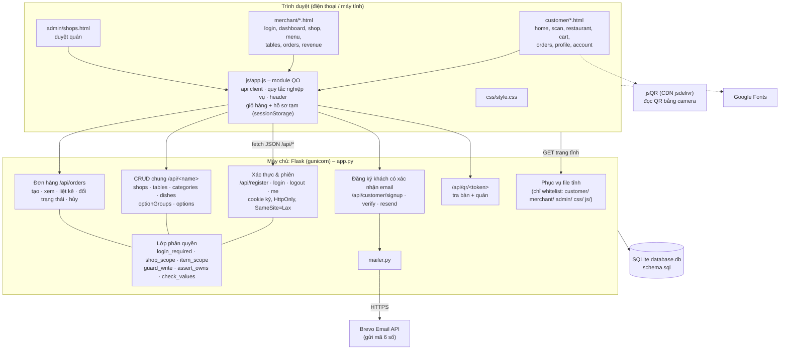
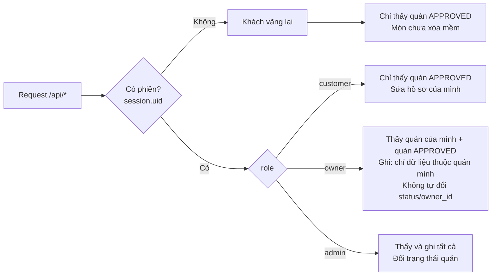
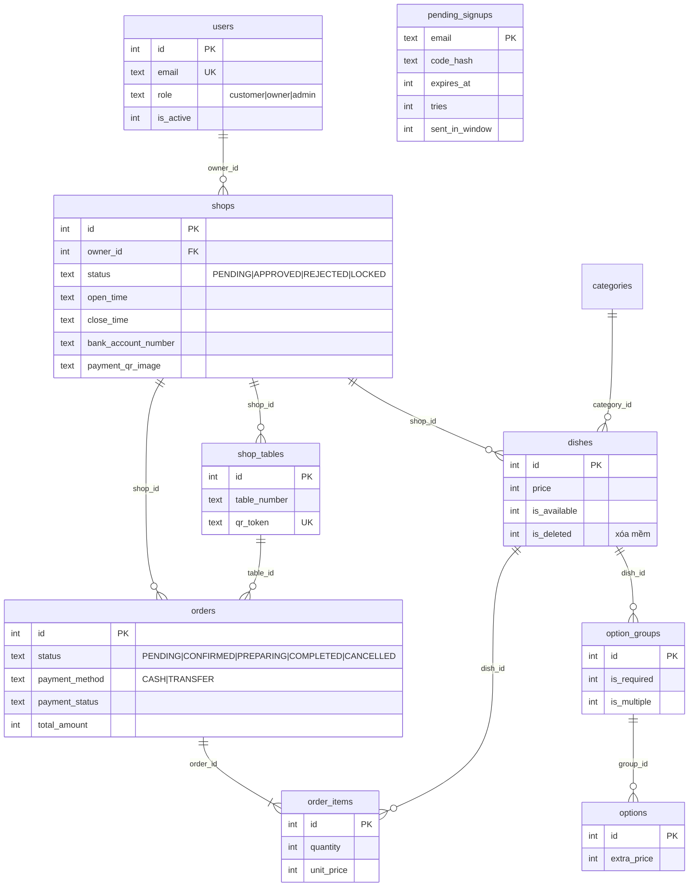
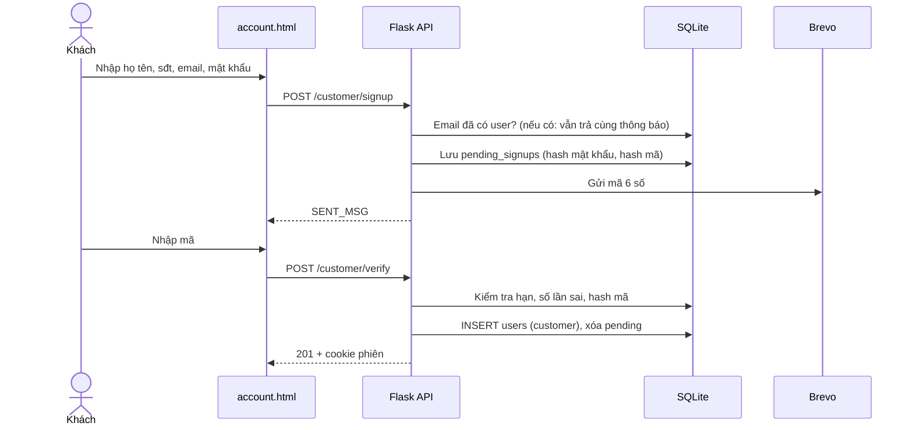
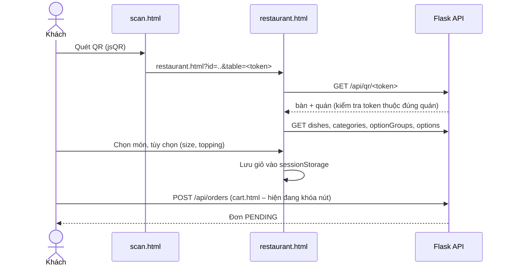
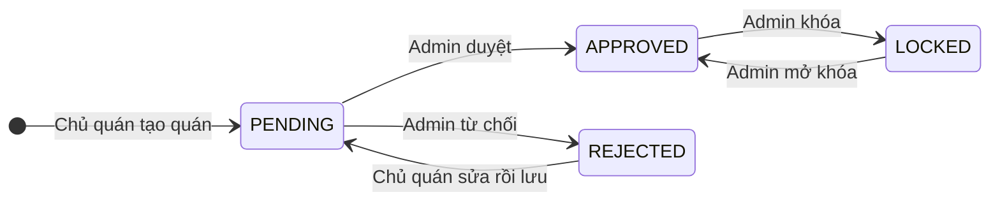
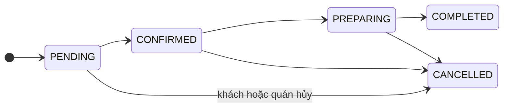

# QuickOrder – Kiến trúc sản phẩm

## 1. Tổng quan sản phẩm

QuickOrder là web app gọi món tại bàn cho quán nhỏ. Khách quét mã QR trên bàn, xem menu và gọi món, không cần tài khoản. Chủ quán quản lý quán, thực đơn, bàn/QR và đơn hàng. Quản trị viên duyệt quán.

| Vai trò | Khu vực | Cách vào | Việc chính |
|---|---|---|---|
| Khách (guest) | `customer/` | Quét QR bàn | Xem menu, giỏ hàng, hồ sơ tạm (sessionStorage) |
| Khách có tài khoản | `customer/` | Đăng ký + xác nhận email | Lưu hồ sơ lâu dài, đăng nhập mọi thiết bị |
| Chủ quán (`owner`) | `merchant/` | Đăng ký/đăng nhập | Hồ sơ quán, menu, bàn & QR, đơn, doanh thu |
| Quản trị (`admin`) | `admin/` | Đăng nhập | Duyệt, từ chối, khóa, mở khóa quán |

## 2. Kiến trúc tổng thể

Mô hình 3 lớp, triển khai một khối (monolith) gọn nhẹ: **Web tĩnh nhiều trang → Flask REST API → SQLite**.

## 3. Các thành phần

### 3.1 Frontend (HTML/CSS/JS thuần, không framework, không bước build)
- **Nhiều trang tĩnh**, mỗi trang tự gọi API qua `QO.api / all / get / by / put / del`.
- **`js/app.js` (module `QO`)** gom: gọi API, quy tắc nghiệp vụ khớp sơ đồ lớp (`isOpenNow` hỗ trợ qua nửa đêm, `isAccepting`, `isOrderable`, `validateSelection`, `qrUrl`), tiện ích (`esc` chống XSS, `money`, `norm` tìm tiếng Việt không dấu), thanh header chung, giỏ hàng và hồ sơ tạm.
- **Trạng thái phía trình duyệt**: giỏ hàng (`qo_cart`) và hồ sơ tạm (`qo_guest`) nằm trong `sessionStorage`, đóng tab là mất. Phiên đăng nhập **không** nằm ở trình duyệt mà là cookie HttpOnly của server.
- **Quét QR**: `scan.html` dùng camera + jsQR, chỉ chấp nhận link cùng origin tới `restaurant.html` có `id` và `table`; có đường dự phòng dán link hoặc mã bàn.

### 3.2 Backend (Flask, một file `app.py`)
| Nhóm | Endpoint | Ghi chú |
|---|---|---|
| Tĩnh | `GET /`, `/<path>` | Whitelist thư mục, chặn `..` |
| Phiên | `POST /api/register` (owner), `/login`, `/logout`, `GET/PUT /api/me` | Khóa đăng nhập 5 lần sai / 15 phút (lưu RAM) |
| Khách | `POST /api/customer/signup`, `/verify`, `/resend` | Mã 6 số, hash, hạn 10 phút, 5 lần sai, gửi lại cách 60 giây, tối đa 5 mã/giờ |
| CRUD | `/api/<name>` GET/POST, `/api/<name>/<id>` GET/PUT/DELETE | `users` không mở qua CRUD |
| QR | `GET /api/qr/<token>` | Trả bàn + quán để kiểm tra trước khi gọi món |
| Đơn | `POST/GET /api/orders`, `GET /api/orders/<id>`, `PUT .../status`, `PUT .../cancel` | Backend đã có, giao diện chưa nối |

- **`mailer.py`**: gửi mã qua API Brevo; `MAIL_CONSOLE=1` để in mã ra terminal khi dev; lỗi gửi trả 502.
- **`init_db.py`**: tạo DB từ `schema.sql`, tạo admin từ biến môi trường. **`seed_data.py`**: nạp dữ liệu mẫu.

### 3.3 Phân quyền (điểm mấu chốt của kiến trúc)

- `shop_scope` / `item_scope`: lọc dữ liệu hiển thị theo vai trò (BR-06).
- `guard_write`: quán mới luôn `PENDING` và thuộc người tạo; không gắn bản ghi vào quán/món/nhóm của người khác; quán `REJECTED` được sửa là tự gửi lại duyệt.
- `qr_token` luôn do server sinh; "Đổi mã" làm mã cũ vô hiệu ngay (BR-07).

## 4. Mô hình dữ liệu

`pending_signups` đứng riêng: email chưa xác nhận chưa chiếm tài khoản trong `users`; chỉ lưu hash mật khẩu và hash mã.

## 5. Luồng chính

### 5.1 Khách đăng ký có xác nhận email

### 5.2 Khách quét QR và đặt món

### 5.3 Vòng đời quán và đơn

## 6. Triển khai và cấu hình
- Chạy dev: `python app.py`. Chạy thật: `gunicorn app:app` (đã có trong `requirements.txt`).
- Biến môi trường: `SECRET_KEY`, `QO_DB`, `HTTPS=1` (cookie Secure), `FLASK_DEBUG`, `MAIL_API_KEY`, `MAIL_FROM`, `MAIL_FROM_NAME`, `MAIL_CONSOLE`, `ADMIN_EMAIL`, `ADMIN_PASSWORD`.
- Kiểm thử: `python -m unittest discover -s tests -v`.
- Lưu ý khi nâng cấp CSDL cũ: `init_db()` chạy `schema.sql` mỗi lần khởi động nên bảng mới (như `pending_signups`) tự được thêm.

## 7. Trạng thái hiện tại và điểm cần lưu ý

**Đã hoàn thiện:** đăng ký/đăng nhập 3 vai trò, xác nhận email, duyệt quán, menu + tùy chọn, bàn + QR + đổi mã, quét QR, giỏ hàng, hồ sơ khách.

**Chưa nối giao diện:** đặt hàng (`cart.html`), đơn của khách, đơn của chủ quán, dashboard đơn, doanh thu (backend đơn đã có, UI còn placeholder).

**Rủi ro/khoảng trống nên xử lý trước khi mở đơn hàng:**
1. `GET /api/orders/<id>` và `PUT /api/orders/<id>/cancel` chưa kiểm tra quyền, ai biết id đều xem và hủy được. Nên gắn token đơn hoặc kiểm tra quyền.
2. `POST /api/orders` chưa tính `extra_price` của tùy chọn và chưa lưu tùy chọn đã chọn vào `order_items` (chỉ có cột `note`), nên tổng tiền sẽ lệch so với giỏ hàng.
3. `create_order` chưa kiểm tra quán có đang trong giờ mở cửa, chưa xác thực `qr_token` của bàn.
4. UI đang có trạng thái "Đang giao" nhưng schema và API không có (`ORDER_STATUSES` chỉ 5 trạng thái); SRS chỉ phục vụ tại bàn nên nên bỏ khỏi UI.
5. Bộ đếm đăng nhập sai (`LOGIN_FAILS`) nằm trong RAM: mất khi restart, và không dùng chung nếu chạy nhiều worker gunicorn.
6. `/api/register` (chủ quán) và `/api/login` chưa có giới hạn tốc độ; `GET /api/<name>` cho phép lọc theo mọi cột, nên cân nhắc whitelist.
7. SQLite phù hợp quy mô nhỏ; khi nhiều quán/nhiều worker, cân nhắc chuyển PostgreSQL.
