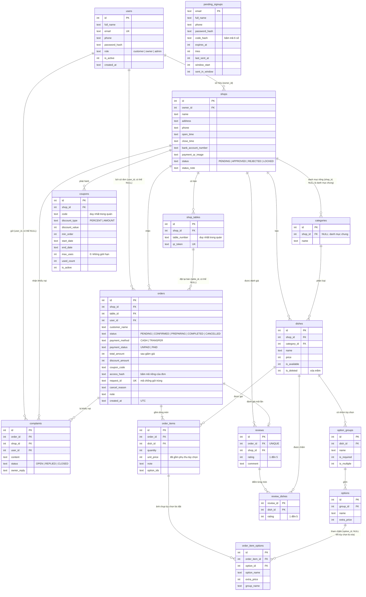

# Thiết kế cơ sở dữ liệu (ERD) QuickOrder

Sơ đồ này vẽ đúng theo `QuickOrder/schema.sql` (SQLite) ở thời điểm hoàn thành Sprint 4, kèm các cột bổ sung trong `init_db()` của `app.py` cho CSDL cũ. Mở bằng GitHub, VS Code (có Mermaid) hoặc [mermaid.live](https://mermaid.live).

## Sơ đồ quan hệ

`pending_signups` đứng riêng: đăng ký khách chờ xác nhận email, chỉ thành dòng trong `users` khi nhập đúng mã.

## Quy ước và ràng buộc đáng chú ý

| Nội dung | Cách thiết kế |
|---|---|
| Khóa ngoại | Bật bằng `PRAGMA foreign_keys = ON` ở mọi kết nối |
| Xóa quán | Xóa bàn, danh mục riêng, món, đơn, mã giảm giá, đánh giá, khiếu nại của quán (`ON DELETE CASCADE`). Chủ quán không xóa được quán, chỉ admin |
| Xóa chủ quán | Bị chặn (`ON DELETE RESTRICT`) khi còn quán |
| Xóa món | Xóa mềm (`is_deleted`) để đơn cũ vẫn giữ tên món; `order_items.dish_id` là `RESTRICT` |
| Xóa bàn | Đơn cũ giữ lại, `table_id` thành NULL |
| Xóa tài khoản khách | `user_id` của đơn và khiếu nại thành NULL |
| Giá | Chốt lúc đặt: `unit_price` gồm giá món cộng phụ thu; `order_item_options` lưu tên và giá thêm, sửa menu sau đó không đổi đơn cũ (BR-04) |
| Mã riêng của đơn | Chỉ lưu băm SHA-256 (`access_hash`); mã gốc trả về một lần |
| Mã chống gửi trùng | `request_id` có chỉ mục duy nhất (NULL không bị tính trùng), mỗi mã chỉ tạo một đơn |
| Mã QR bàn | `qr_token` duy nhất, sinh ngẫu nhiên ở máy chủ; đổi mã thì mã cũ vô hiệu |
| Mật khẩu và mã xác nhận | Chỉ lưu băm (`password_hash`, `code_hash`) |
| Thời gian | Lưu UTC; thống kê theo ngày tính theo giờ Việt Nam (UTC+7) |
| Danh mục | Tên không phân biệt hoa thường, duy nhất trong phạm vi (chung hoặc theo quán) |
| Chỉ mục | `orders(shop_id)`, `orders(status)`, `orders(user_id, id)`, `orders(table_id, payment_status)`, `orders(request_id)` duy nhất, `reviews(shop_id, id)`, `complaints(shop_id, status, id)` và các chỉ mục khóa ngoại khác |
