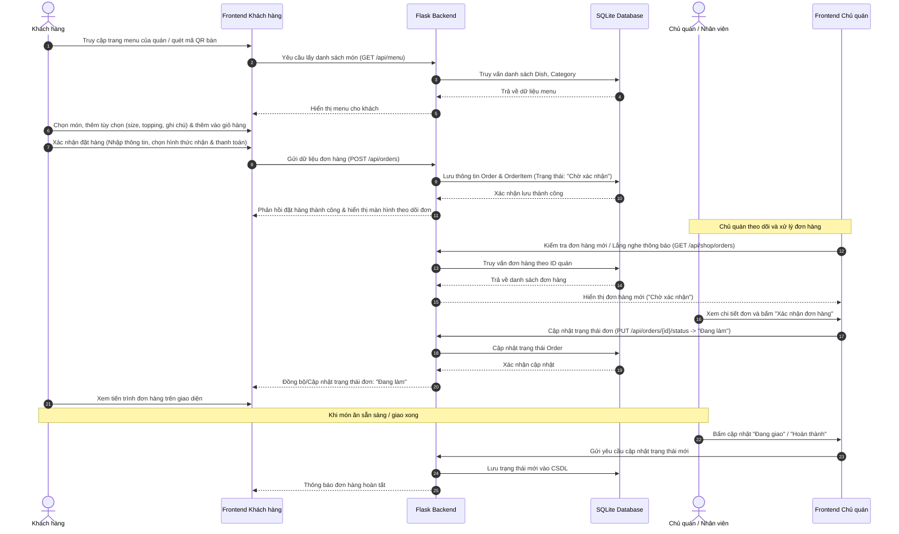

# Sequence Diagram - TULO Quickorder

Dưới đây là sơ đồ tuần tự (Sequence Diagram) cho luồng cốt lõi **Đặt món và Xử lý đơn hàng** của hệ thống **TULO Quickorder**, được viết bằng mã nguồn chuẩn **Mermaid.js**. Bạn có thể copy nội dung bên dưới dán vào các công cụ hỗ trợ Mermaid (như Notion, GitHub, draw.io hoặc [Mermaid Live Editor](https://mermaid.live)) để hiển thị thành hình ảnh sơ đồ hoàn chỉnh.

## Các Sequence Diagram bổ sung gợi ý cho nhóm:
1. **Luồng Đăng ký / Đăng nhập & Phân quyền:**
   * Tác nhân: Người dùng (Khách hàng / Chủ quán / Admin) $\rightarrow$ Frontend $\rightarrow$ Backend (Kiểm tra mật khẩu đã mã hóa) $\rightarrow$ Database $\rightarrow$ Phân quyền điều hướng màn hình phù hợp.
2. **Luồng Quản lý Menu của Chủ quán:**
   * Tác nhân: Chủ quán $\rightarrow$ Frontend Chủ quán $\rightarrow$ Backend $\rightarrow$ Database (Thêm, Sửa, Xóa món hoặc cập nhật trạng thái còn/hết hàng).