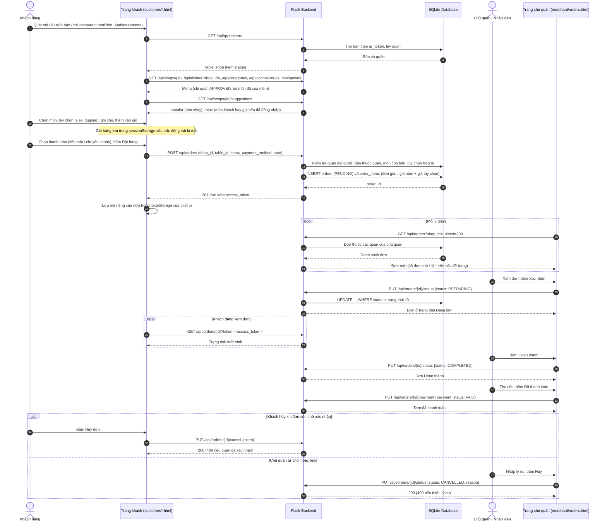
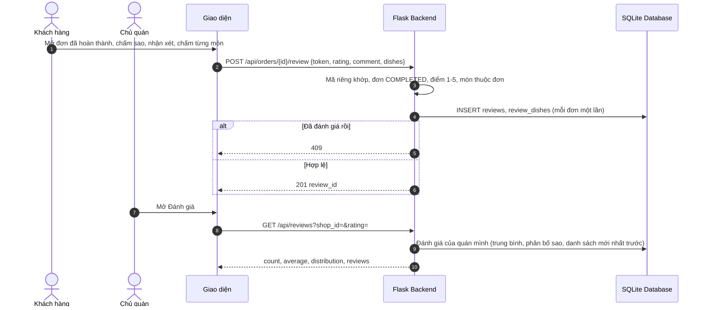

# Sequence Diagram - TULO QuickOrder

Tài liệu gồm các sơ đồ tuần tự (Sequence Diagram) viết bằng mã nguồn **Mermaid.js**, khớp với mã nguồn đã hoàn thành đến hết **Sprint 3** (endpoint, trạng thái đơn và quy tắc nghiệp vụ lấy từ `QuickOrder/app.py`, `admin_api.py`, `complaint_api.py`). GitHub hiển thị trực tiếp các sơ đồ này; có thể dán vào [Mermaid Live Editor](https://mermaid.live) hoặc draw.io để xuất hình.

Bản thiết kế ban đầu (9 luồng, kiến trúc Jinja2) nằm ở [docs/SequenceDiagram_QuickOrder_v1.0.docx](docs/SequenceDiagram_QuickOrder_v1.0.docx). Bản triển khai thực tế dùng trang HTML tĩnh gọi API JSON dưới tiền tố `/api`.

**Quy ước chung**

- Trạng thái đơn: `PENDING` (Chờ xác nhận) → `PREPARING` (Đang làm) → `COMPLETED` (Hoàn thành); `CANCELLED` (Đã hủy) khi khách hủy lúc chờ xác nhận hoặc chủ quán hủy trước khi hoàn thành (kèm lý do). Không còn trạng thái "Đang giao" vì quán chỉ phục vụ khách ngồi tại bàn.
- Khách ẩn danh dùng **mã riêng của đơn** (`access_token`, chỉ trả về một lần khi gửi đơn, server chỉ lưu băm) để xem, hủy, đánh giá và khiếu nại đơn của mình.
- Giá tính ở server: khách không gửi giá, chỉ gửi `dish_id`, `quantity`, `option_ids`.

## 1. Đặt món và xử lý đơn hàng (FR-10 đến FR-20, FR-39 đến FR-44)



## 2. Mã giảm giá của quán và áp dụng khi đặt món (FR-46, FR-23)

```mermaid
sequenceDiagram
    autonumber
    actor ChuQuan as Chủ quán
    actor KhachHang as Khách hàng
    participant FE as Giao diện
    participant Backend as Flask Backend
    participant DB as SQLite Database

    ChuQuan->>FE: Tạo mã (code, % hoặc số tiền, đơn tối thiểu, thời hạn, số lượt)
    FE->>Backend: POST /api/coupons
    Backend->>Backend: Kiểm tra mã 3-20 ký tự, giá trị, ngày; quán thuộc chủ quán
    Backend->>DB: INSERT coupons (mã không trùng trong quán)
    Backend-->>FE: 201 mã (state: ACTIVE)

    KhachHang->>FE: Nhập mã ở giỏ hàng
    FE->>Backend: POST /api/orders/quote (shop_id, items, coupon_code)
    Backend->>DB: Tính tạm tính, tìm mã của đúng quán
    alt Mã không dùng được
        Backend-->>FE: 400 kèm lý do (không tồn tại, tạm tắt, hết hạn, chưa tới ngày, hết lượt, chưa đủ đơn tối thiểu)
    else Mã hợp lệ
        Backend-->>FE: subtotal, discount, total
    end

    KhachHang->>FE: Bấm Đặt hàng
    FE->>Backend: POST /api/orders (coupon_code)
    Backend->>DB: UPDATE coupons SET used_count + 1 nếu còn lượt (kiểm tra lại, tránh hai khách cùng lúc vượt giới hạn)
    Backend->>DB: INSERT orders (total_amount sau giảm, discount_amount, coupon_code)
    Backend-->>FE: 201 đơn

    opt Đơn bị hủy (khách hoặc chủ quán)
        Backend->>DB: used_count - 1 (trả lại lượt dùng)
    end
```

## 3. Tính tiền theo bàn (FR-45)

```mermaid
sequenceDiagram
    autonumber
    actor ChuQuan as Chủ quán
    participant FE as merchant/bills.html
    participant Backend as Flask Backend
    participant DB as SQLite Database

    ChuQuan->>FE: Mở Tính tiền bàn
    FE->>Backend: GET /api/shops/{id}/bills
    Backend->>DB: Đơn UNPAID, không phải CANCELLED, nhóm theo bàn
    Backend-->>FE: Danh sách bàn: các đơn, tổng tiền cần thu
    ChuQuan->>FE: Thu tiền cả bàn (hoặc chọn một số đơn)
    FE->>Backend: POST /api/tables/{table_id}/settle {order_ids?}
    Backend->>Backend: Bàn thuộc quán của chủ quán; order_ids chỉ trong bàn này
    Backend->>DB: UPDATE orders SET payment_status = PAID
    alt Còn đơn cần thanh toán
        Backend-->>FE: settled (số đơn), total
    else Không còn đơn
        Backend-->>FE: 409 Bàn này không còn đơn cần thanh toán
    end
```

## 4. Đánh giá quán và món (FR-24, FR-49)



## 5. Lịch sử đơn, đặt lại món và gợi ý món (FR-21, FR-22, FR-25)

```mermaid
sequenceDiagram
    autonumber
    actor KhachHang as Khách có tài khoản
    participant FE as customer/history.html
    participant Backend as Flask Backend
    participant DB as SQLite Database

    KhachHang->>FE: Mở Lịch sử
    FE->>Backend: GET /api/my/orders?status=&before=
    Backend->>DB: Đơn có user_id = khách, mới nhất trước, phân trang
    Backend-->>FE: orders, next_before

    opt Đơn đặt trước khi đăng nhập
        KhachHang->>FE: Chọn Lưu vào lịch sử
        FE->>Backend: POST /api/my/orders/{id}/claim {token}
        Backend->>DB: Gán user_id nếu đơn chưa thuộc tài khoản nào (và các khiếu nại ẩn danh của đơn)
        Backend-->>FE: Đơn đã vào lịch sử (404 nếu sai mã hoặc đơn của người khác)
    end

    KhachHang->>FE: Bấm Đặt lại ở một đơn cũ
    FE->>Backend: POST /api/my/orders/{id}/reorder
    Backend->>DB: Kiểm tra từng dòng với menu hiện tại (còn món, tùy chọn còn hợp lệ), lấy giá hiện tại
    Backend-->>FE: items (đặt lại được), skipped (kèm lý do), accepting
    FE->>FE: Đưa các dòng vào giỏ; khách tự gửi đơn mới ở bước sau (không ghi CSDL)
```

## 6. Khiếu nại: khách gửi, chủ quán xử lý (FR-26, FR-55)

```mermaid
sequenceDiagram
    autonumber
    actor KhachHang as Khách hàng
    actor ChuQuan as Chủ quán
    participant FE as Giao diện
    participant Backend as Flask Backend
    participant DB as SQLite Database

    KhachHang->>FE: Nhập nội dung khiếu nại cho một đơn
    FE->>Backend: POST /api/orders/{id}/complaints {content, token?}
    Backend->>Backend: Khách là chủ đơn hoặc có mã riêng; nội dung 10-500 ký tự
    Backend->>Backend: Đơn không còn chờ xác nhận; không có khiếu nại chưa đóng; tối đa 5 khiếu nại mỗi đơn
    Backend->>DB: INSERT complaints (OPEN)
    Backend-->>FE: 201

    ChuQuan->>FE: Mở Khiếu nại
    FE->>Backend: GET /api/merchant/complaints?status=
    Backend->>DB: Chỉ khiếu nại của các quán thuộc chủ quán này
    Backend-->>FE: items, total
    ChuQuan->>FE: Nhập phản hồi
    FE->>Backend: PUT /api/merchant/complaints/{id}/reply {owner_reply}
    Backend->>DB: owner_reply, status = REPLIED
    ChuQuan->>FE: Bấm Đóng khiếu nại
    FE->>Backend: PUT /api/merchant/complaints/{id}/close
    Backend->>DB: status = CLOSED (409 nếu chưa có phản hồi)

    KhachHang->>FE: Mở lại đơn
    FE->>Backend: GET /api/orders/{id}/complaints
    Backend-->>FE: Trạng thái và phản hồi của chủ quán
```

## 7. Quản trị viên: duyệt, khóa quán và quản lý người dùng (FR-50 đến FR-54)

```mermaid
sequenceDiagram
    autonumber
    actor Admin as Quản trị viên
    participant FE as admin/*.html
    participant Backend as Flask Backend
    participant DB as SQLite Database

    Admin->>FE: Đăng nhập tại /admin/shops.html
    FE->>Backend: POST /api/login
    Backend-->>FE: role = admin (vai trò khác bị đăng xuất khỏi trang này)

    Admin->>FE: Duyệt, từ chối, khóa hoặc mở khóa quán (từ chối và khóa kèm lý do)
    FE->>Backend: PUT /api/shops/{id} {status, status_note}
    Backend->>DB: UPDATE shops (APPROVED, REJECTED, LOCKED)
    Note over Backend,DB: Quán không còn APPROVED thì ẩn khỏi khách và không nhận đơn; mở khóa thì mã QR cũ dùng lại được

    Admin->>FE: Tìm, lọc người dùng
    FE->>Backend: GET /api/admin/users?q=&role=&is_active=&limit=&offset=
    Backend-->>FE: items (không có password_hash), total
    Admin->>FE: Khóa hoặc mở khóa tài khoản
    FE->>Backend: PUT /api/admin/users/{id}/status {is_active}
    Backend-->>FE: 200 (409 nếu tự khóa chính mình)
    Note over Backend: Tài khoản bị khóa mất phiên đang dùng và không đăng nhập được

    Admin->>FE: Thêm, sửa, xóa danh mục
    FE->>Backend: POST, PUT, DELETE /api/categories
    Backend-->>FE: 409 nếu trùng tên hoặc danh mục đang có món

    Admin->>FE: Mở Thống kê
    FE->>Backend: GET /api/admin/statistics
    Backend->>DB: Đếm quán, người dùng, đơn; tổng doanh thu đơn COMPLETED
    Backend-->>FE: shops, users, orders, revenue
```

## Các luồng khác (xem tài liệu thiết kế)

- **Đăng ký chủ quán và đăng nhập, phân quyền:** `POST /api/register`, `POST /api/login`; khóa tạm 15 phút sau 5 lần sai mật khẩu.
- **Đăng ký tài khoản khách có xác nhận email:** `POST /api/customer/signup` gửi mã 6 số qua Brevo (hiệu lực 10 phút), `POST /api/customer/verify` tạo tài khoản, `POST /api/customer/resend` gửi lại (cách nhau 60 giây, tối đa 5 mã mỗi giờ).
- **Quản lý menu, bàn và mã QR của chủ quán:** CRUD qua `/api/dishes`, `/api/optionGroups`, `/api/options`, `/api/tables` (đổi mã QR bằng `regenerate`); mã QR chỉ tạo ở server.
- **Thống kê doanh thu của chủ quán:** `GET /api/revenue?shop_id=&range=` (chỉ đơn Hoàn thành, ngày theo giờ Việt Nam).
